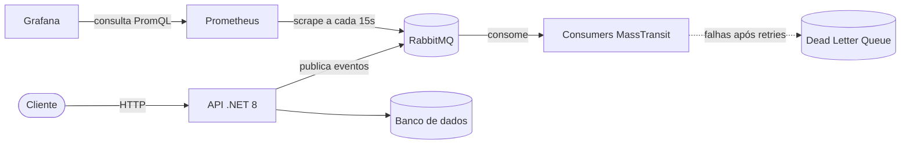

# ProjetoFixacao

API REST em **.NET 8** com **mensageria assíncrona (RabbitMQ + MassTransit)** e **observabilidade (Prometheus + Grafana)**, toda orquestrada com **Docker Compose**.

Projeto criado para praticar, os pilares de um backend moderno: desacoplamento via mensageria, resiliência no consumo de mensagens e monitoramento do ambiente.

---

## O que este projeto demonstra

- **API REST** com ASP.NET Core, Entity Framework Core (migrations) e documentação via Swagger
- **Mensageria com RabbitMQ**: publicação e consumo de eventos de forma assíncrona
- **Resiliência com MassTransit**: política de _retry_, _Dead Letter Queue_ e limite de concorrência nos consumidores
- **Observabilidade**: métricas coletadas pelo Prometheus e visualizadas em dashboards no Grafana
- **Infraestrutura como código**: ambiente completo sobe com um único comando

---

## Arquitetura



| Componente      | Papel                                                                |
| --------------- | -------------------------------------------------------------------- |
| **API .NET**    | Expõe os endpoints REST e publica eventos                            |
| **RabbitMQ**    | Broker de mensagens que desacopla produtores e consumidores          |
| **MassTransit** | Abstração sobre o RabbitMQ com retry, DLQ e controle de concorrência |
| **Prometheus**  | Coleta e armazena as métricas (scrape)                               |
| **Grafana**     | Dashboards para visualizar as métricas                               |

---

## Tecnologias

`C#` · `.NET 8` · `ASP.NET Core` · `Entity Framework Core` · `MassTransit` · `RabbitMQ` · `Docker Compose` · `Prometheus` · `Grafana` · `Swagger`

---

## Como rodar

### Pré-requisitos

- [.NET 8 SDK](https://dotnet.microsoft.com/download/dotnet/8.0)
- [Docker Desktop](https://www.docker.com/products/docker-desktop)

### 1. Clone o repositório

```bash
git clone https://github.com/Kleycf/ProjetoFixacao.git
cd ProjetoFixacao
```

### 2. Suba a infraestrutura (RabbitMQ, Prometheus e Grafana)

```bash
cd ProjetoFixacao
docker compose up -d
```

### 3. Rode a API

```bash
dotnet run --project ProjetoFixacao.API
```

### Endereços

| Serviço           | URL                              | Acesso            |
| ----------------- | -------------------------------- | ----------------- |
| Swagger (API)     | `http://localhost:23681/swagger` | -                 |
| RabbitMQ (painel) | `http://localhost:15672`         | `guest` / `guest` |
| Prometheus        | `http://localhost:9090`          | -                 |
| Grafana           | `http://localhost:3000`          | `admin` / `admin` |

> No Grafana, adicione o Prometheus como _data source_ com a URL `http://prometheus:9090` e importe o dashboard de ID **10991** (RabbitMQ Overview).

Para parar tudo:

```bash
docker compose down
```

---

## Decisões de design

- **Por que mensageria?** Para desacoplar quem publica de quem processa. Se o consumidor falhar ou ficar lento, a API continua respondendo e as mensagens aguardam na fila.
- **Por que Dead Letter Queue?** Mensagens que falham após todas as tentativas não se perdem: vão para uma fila separada para análise.
- **Por que MassTransit?** Evita código repetitivo com o cliente nativo do RabbitMQ e entrega retry e DLQ prontos.
- **Por que Prometheus + Grafana?** Sem métricas, não dá para saber se um problema está na API, no broker ou na infraestrutura.
- **Dados do Grafana persistidos em _named volume_** para não perder dashboards ao derrubar os containers. Métricas do Prometheus não são persistidas por ser um ambiente de desenvolvimento.

---

## Próximos passos

- [ ] Testes de integração com filas
- [ ] Apache Kafka para streaming de eventos
- [ ] Logs estruturados com Serilog
- [ ] Pipeline de CI com GitHub Actions

---

## Autor

**Kleyton Couto Ferreira**
Estudante de Análise e Desenvolvimento de Sistemas, focado em backend .NET e mensageria.

[GitHub](https://github.com/Kleycf) · [LinkedIn](https://www.linkedin.com/in/SEU_PERFIL)
